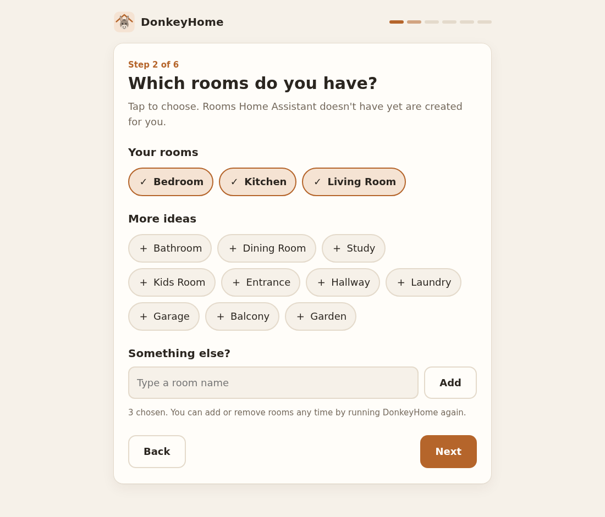
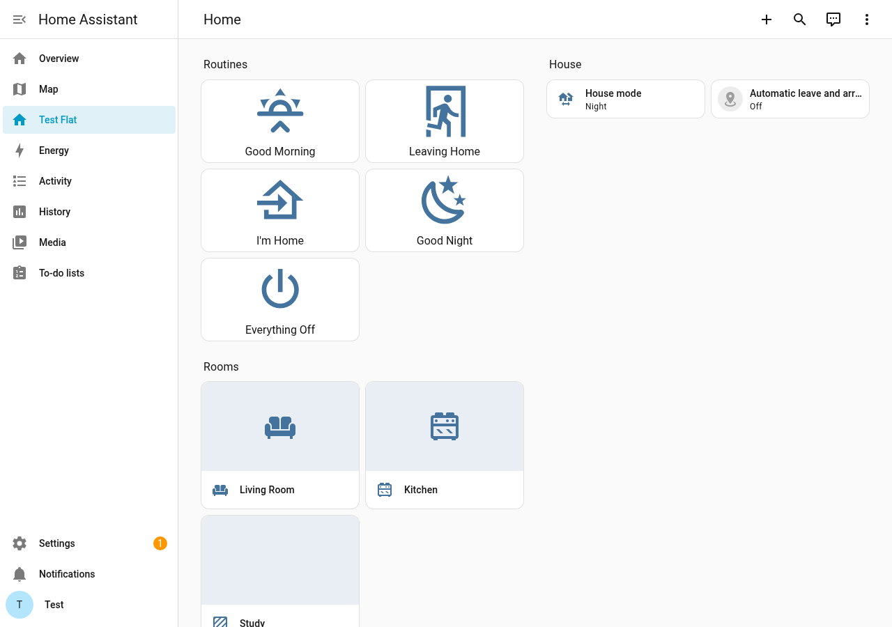

<p align="center"></p>

**Set up your smart home by answering six easy questions.** No programming, no files, no command line.

DonkeyHome is an app that runs inside Home Assistant. You click through six friendly screens (your home's name, your rooms, who lives there, coming and going, what should happen, check) and it sets everything up for you:

- **Five one-tap routines:** Good Morning, Leaving Home, I'm Home, Good Night, Everything Off.
- **Automatic leave and arrive:** when the last phone leaves, the house switches off and tells you; when the first one comes back, the arrival room lights up after dark.
- **A dashboard** with the routines, the house mode and one card per room.
- **Phone messages** through the Home Assistant app, and a weekly list of batteries to change.
- **Any brand:** routines use "every light", "every fan" and so on, so new devices join in by themselves.

It's safe: DonkeyHome backs up every file it changes, has Home Assistant check the new setup, and puts everything back if there is any problem. It never touches automations you made yourself.

<p align="center"> </p>

## Install

Already have Home Assistant? Click:

[](https://my.home-assistant.io/redirect/supervisor_add_addon_repository/?repository_url=https%3A%2F%2Fgithub.com%2Fchuatzeyee%2FDonkeyHome)

Then **Install** > **Start** > **Open web UI**. Full steps with pictures: [guide 2](docs/02-setting-up.md).

## The guides

Written for complete beginners. Each step ends with a ✅ check, and each guide ends with "If something goes wrong".

| | Guide | Time |
|---|---|---|
| 1 | [Getting started: install Home Assistant](docs/01-getting-started.md) (which box to buy, installing, first login, phones, backups) | 1 hour |
| 2 | [Setting up: install DonkeyHome and answer six questions](docs/02-setting-up.md) | 15 minutes |
| 3 | [Adding devices](docs/03-adding-devices.md) | 5 to 10 minutes per device |
| 4 | [Routines and making changes](docs/04-routines-and-changes.md) | as you like |
| 5 | [Looking after it](docs/05-looking-after-it.md) (updates, backups, remote access, troubleshooting) | 5 minutes a month |
| | [Advanced: without the app](docs/advanced-command-line.md) (Container installs, developers) | |

Works with Home Assistant OS (Home Assistant Green, Raspberry Pi, mini PC, virtual machine) on Home Assistant 2026.10 and newer.

## What's in this repository

```text
repository.yaml        tells Home Assistant this is an app repository
donkeyhome/            the app: config.yaml, Dockerfile, DOCS.md, icon and logo
  app/server.py        the web page's server (runs inside Home Assistant)
  app/wizard.py        turns your answers into Home Assistant files (also a command-line tool)
  app/haclient.py      talks to Home Assistant
  app/web/             the six screens
config/                example of what DonkeyHome writes (4 rooms, 2 people)
example-answers.json   the answers behind that example
docs/                  the guides
tests/                 offline checks, plus an end-to-end test with a real Home Assistant
```

## License

MIT. See [LICENSE](LICENSE).
