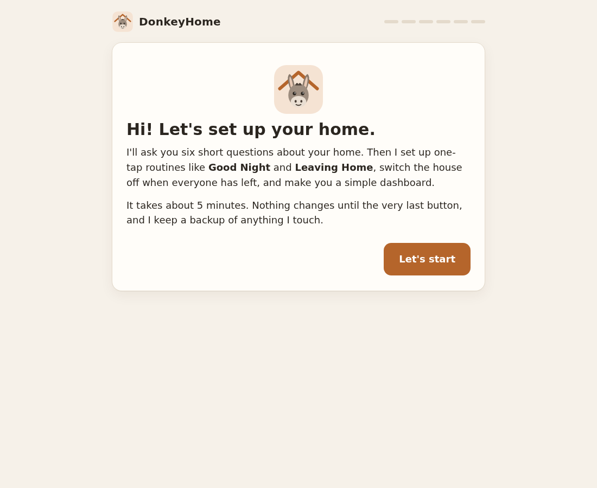
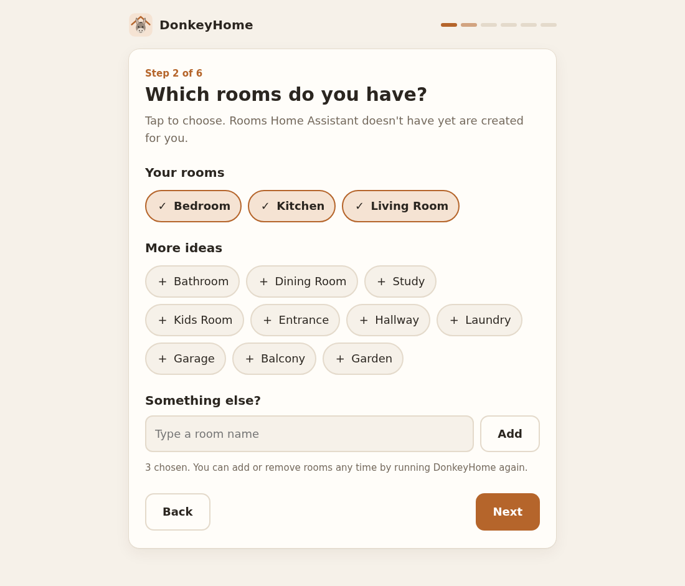
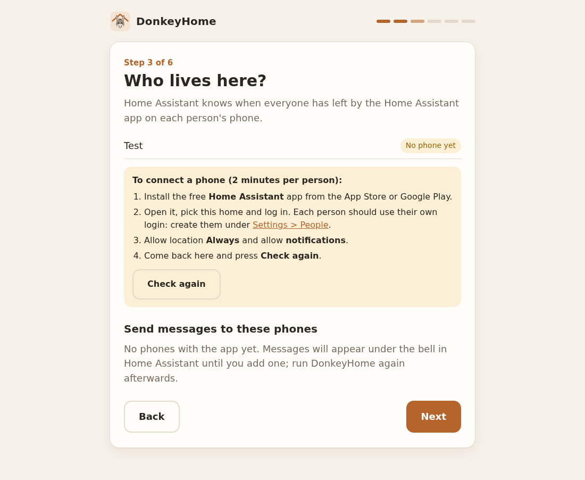
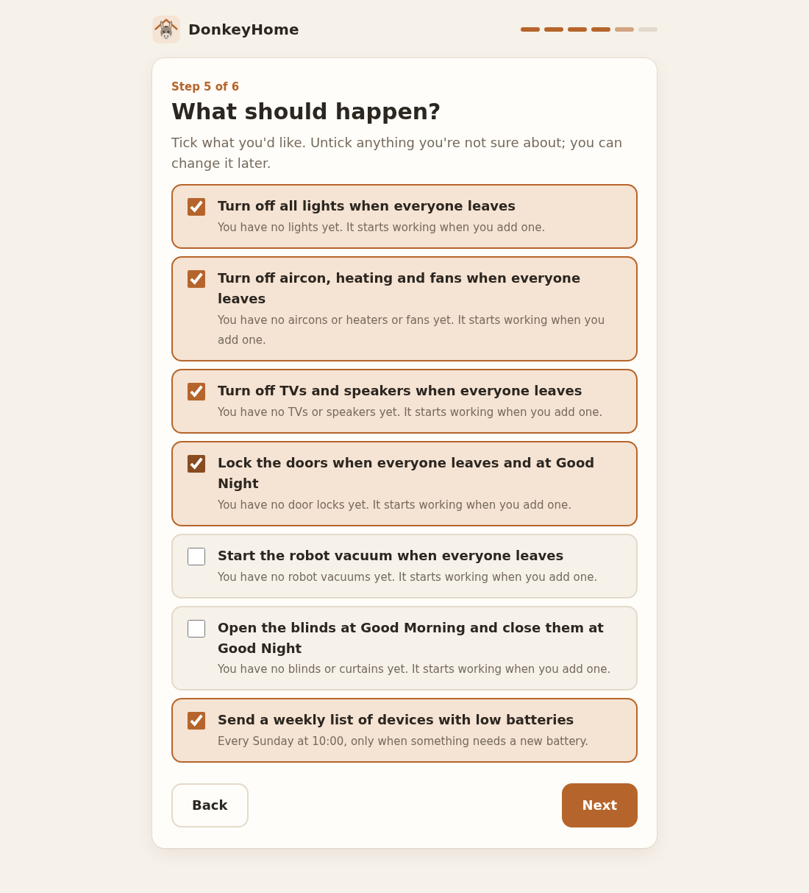
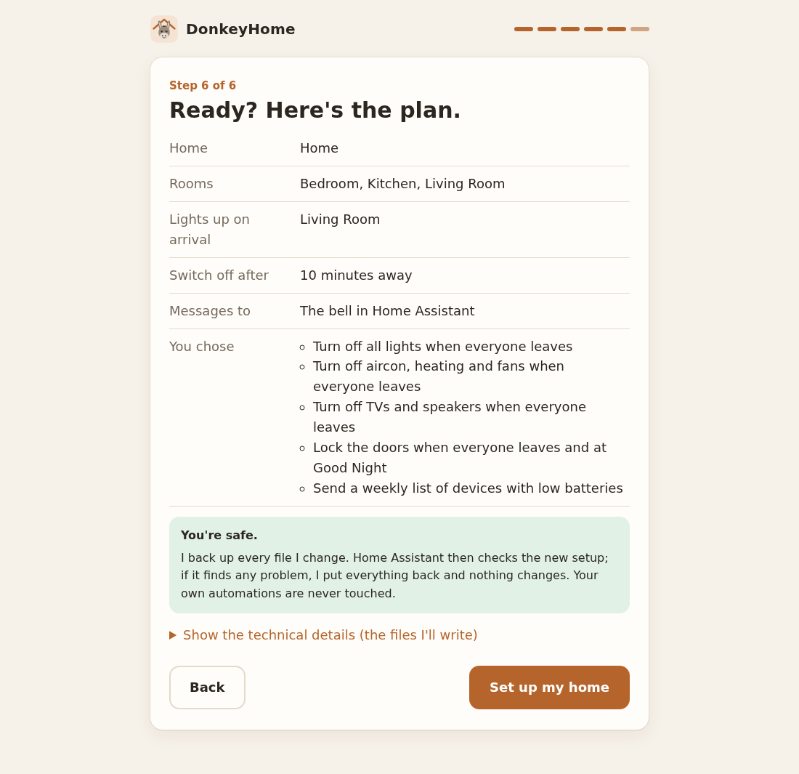
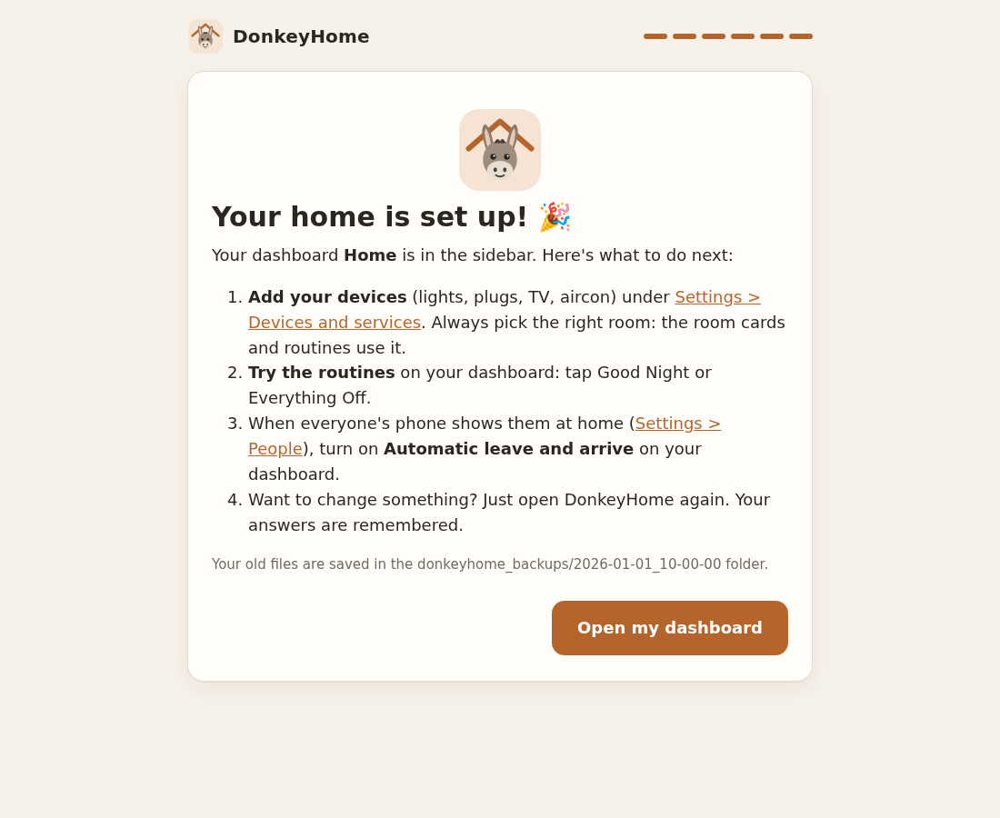
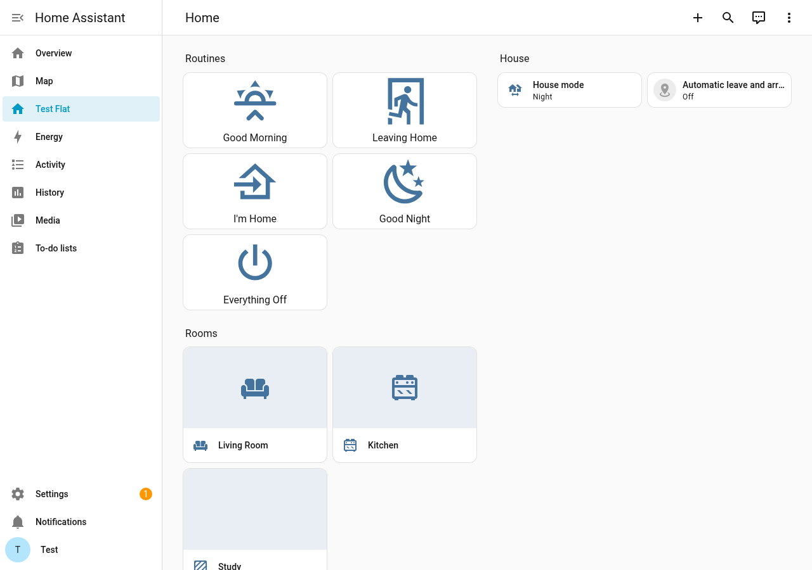

# 2. Setting up: install DonkeyHome and answer six questions

**What you'll do:** add the DonkeyHome app to Home Assistant, answer six easy questions, and get your routines and dashboard.
**Time:** about 15 minutes.
**You need:** guide 1 finished, and your Home Assistant login. Nothing to download or install on your computer.

---

## Step 1: Add DonkeyHome to Home Assistant

You do this once.

**The easy way (one click):**

1. On the computer where you use Home Assistant, click this button:

   

2. The first time, a page asks for your Home Assistant's address. Type `http://homeassistant.local` (or the address you use, like `http://192.168.1.50`) and click **Save**. Then click **Open link**.
3. Home Assistant opens and asks **"Add repository?"** Click **Add**.

**If the button doesn't work**, do it by hand:

1. In Home Assistant, go to **Settings > Apps > Install app**.
2. Click the **three dots** in the top right corner > **Repositories**.
3. Paste `https://github.com/chuatzeyee/DonkeyHome` and click **Add**, then **Close**.

✅ Check: in **Settings > Apps > Install app**, scroll down: there is a **DonkeyHome** section with the donkey icon.

---

## Step 2: Install and start it

1. **Settings > Apps > Install app** > click **DonkeyHome**.
2. Click **Install**. It takes 1 to 3 minutes (longer on a Raspberry Pi). Wait until the **Install** button changes to **Start**.
3. Click **Start**.
4. Turn on **Show in sidebar**.
5. Click **Open web UI**.

✅ Check: a page with a smiling donkey says **"Hi! Let's set up your home."**

---

## Step 3: Answer the six questions

Click **Let's start**. Each screen asks one thing. Nothing changes in your Home Assistant until the very last button, so feel free to click around and go **Back**.

### 1. What do you call your home?

Any name, like `The Tan Home`. It becomes the name of your dashboard.

### 2. Which rooms do you have?

- Rooms Home Assistant already knows have a tick. Tap one to remove it.
- Tap any idea under **More ideas** to add it, or type your own under **Something else?** and click **Add**.
- Don't worry about rooms that don't exist yet: DonkeyHome creates them for you.

### 3. Who lives here?

DonkeyHome shows everyone Home Assistant knows and whether their phone is connected.

- **"Phone connected"** means the Home Assistant app on their phone is set up. 
- **"No phone yet"**: follow the four steps in the yellow box on the screen (or guide 1, Step 5), then click **Check again**. You can also skip this and run DonkeyHome again later.
- Under **Send messages to these phones**, the ticked phones get messages like "Everyone has left".

### 4. Coming and going

- **Which room should light up when you come home after dark?** Usually the room by your front door.
- **How long after the last person leaves should the house switch off?** 10 minutes is a good start.

### 5. What should happen?

Tick what you'd like. Under each one, DonkeyHome tells you how many matching devices you have. "You have no door locks yet" is fine: it starts working as soon as you add one.

### 6. Check and set up

Read the summary. If something is wrong, click **Back**. When it looks right, click **Set up my home**.

---

## Step 4: Wait about a minute

DonkeyHome now:

1. creates any rooms you added,
2. saves a backup of every file it changes (in a folder called `donkeyhome_backups`),
3. writes your routines and dashboard,
4. asks Home Assistant to check everything. **If anything is wrong, it puts your old files back and nothing changes.**
5. restarts Home Assistant.

Keep the page open. When Home Assistant is back, you see this:

✅ Check: click **Open my dashboard**. You see your **Routines**, **House** and **Rooms**:

---

## Step 5: Add your devices

Your routines work with whatever devices you have, and pick up new ones by themselves. Guide 3 shows how to add devices. The one rule: **always put each device in its room.**

---

## Step 6: Switch on automatic leave and arrive

Once everyone's phone shows them at **Home** under **Settings > People**:

1. Open your dashboard.
2. Under **House**, turn on **Automatic leave and arrive**.

From now on:

- When **everyone** has been away for the minutes you chose, **Leaving Home** runs and you get a message.
- When the **first person** comes back, **I'm Home** runs.

✅ Check: next time everyone goes out, your phones get "Everyone has left. The house is switched off."

---

## Step 7: Try the routines

Tap each button under **Routines** once while you're home:

| Button | What it does |
|---|---|
| **Good Morning** | House mode Home; opens the blinds (if you chose that). |
| **Leaving Home** | House mode Away; switches off what you chose; locks the doors (if chosen); sends a message. |
| **I'm Home** | House mode Home; lights in your arrival room if it is dark outside. |
| **Good Night** | House mode Night; lights and TVs off; locks and closes blinds (if chosen). |
| **Everything Off** | Lights, fans, aircon, TVs and speakers off. Nothing else. |

---

## Changing your answers later

Open **DonkeyHome** in the sidebar any time. Your previous answers are filled in; change what you like and click **Set up my home** again. Do this whenever you:

- add a room,
- connect a new phone (so it gets messages),
- change your mind about a choice.

---

## If something goes wrong

| Problem | Try this |
|---|---|
| There is no **Apps** item in Settings | Your Home Assistant was installed as a "Container" or "Core" (not the normal way from guide 1). Apps only exist on Home Assistant OS. Use the [advanced command-line method](advanced-command-line.md) instead. |
| The one-click button says "No Home Assistant instance" | Type your Home Assistant's address when asked (Step 1.2), or add the repository by hand. |
| DonkeyHome isn't in the app list after adding the repository | Refresh the page. Or **Install app** > three dots > **Check for updates**. |
| Install fails or takes ages | Check the box has internet. Click **Install** again; it continues where it stopped. |
| "DonkeyHome couldn't talk to Home Assistant" | Click **Try again**. If it keeps happening, restart the app (**Settings > Apps > DonkeyHome > Restart**). |
| "That didn't work, but nothing was changed" | The message says why. Your old files are back. Click **Try again**; if it fails again, open **Settings > Apps > DonkeyHome > Log** and share it when you ask for help. |
| "Someone has edited this Home Assistant's settings file by hand" | Someone added their own lines to `configuration.yaml`. DonkeyHome replaces that file (a copy is kept in `donkeyhome_backups`). If someone else set up your Home Assistant, ask them first. |
| The page stays on "Waiting for Home Assistant to come back" | Wait 5 minutes, then refresh the browser. Everything was already set up; only the page lost track. |
| A room card shows a red error | Open DonkeyHome again and click **Set up my home**: it recreates missing rooms. |

**Next:** [3. Adding devices](03-adding-devices.md)
